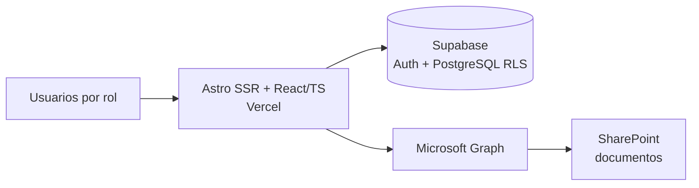

# ohs-training-compliance-app

**App web de Seguridad y Salud Ocupacional: capacitaciones y cumplimiento legal**

> 🔒 **Código privado.** Este repositorio es un *showcase*: documenta el problema, la solución y la arquitectura. El código fuente pertenece a un proyecto profesional y no se publica. No incluye datos reales, credenciales ni información de clientes.

## English summary
A production web app for occupational health & safety: worker training records, per-project compliance plans and legal compliance documents, with Supabase Auth + row-level security (6 roles) and SharePoint (Microsoft Graph) as document storage. Available to a 50-person organization and used daily by 2 administrators.

## Problema
Los registros de capacitaciones, diplomas y documentos legales estaban dispersos en planillas y carpetas, sin control de vencimientos ni de quién podía ver datos sensibles.

## Solución
- Registro de **capacitaciones por trabajador** con vencimientos.
- **Plan de cumplimiento** por proyecto.
- Módulo de **cumplimiento legal** (reglamento interno, políticas, matriz de riesgos).
- **Dashboard** de estado.
- **6 roles** con seguridad a nivel de fila (RLS), incluido un rol restringido para datos de salud.
- **SharePoint** como repositorio documental vía Microsoft Graph.
- Migración de 481 registros históricos.

## Arquitectura

## Stack
Astro (SSR) · React · TypeScript · Tailwind · Supabase (Auth, PostgreSQL, RLS) · Microsoft Graph / SharePoint · Vercel · Vitest

## Métricas verificadas
| Indicador | Valor |
|---|---|
| Estado | En producción |
| Usuarios con acceso | organización de 50 personas |
| Administradores activos | 2 |
| Roles | 6 |
| Registros migrados | 481 |

## Capturas
<!-- TODO: mockups con datos ficticios -->

## Autor
Tito Ruiz Haros · [github.com/titoruizh](https://github.com/titoruizh)
